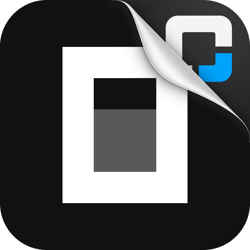

<p align="center">
  
</p>

<h1 align="center">OMC OpenCode Zen Free</h1>

<p align="center">
  <a href="https://github.com/WizisCool/oh-my-cpa">
    <picture>
      <source media="(prefers-color-scheme: dark)" srcset="https://raw.githubusercontent.com/WizisCool/oh-my-cpa/main/web/src/assets/brand/omc-wordmark-dark.svg">
      
    </picture>
  </a>
</p>

<p align="center">
  OpenCode Zen's free models adapted for Oh-My-CPA, compatible with
  <a href="https://github.com/router-for-me/CLIProxyAPI">CLIProxyAPI</a>
</p>

<p align="center">
  <a href="https://github.com/omc-community/omc-opencode-zen-free/releases"></a>
  <a href="https://github.com/omc-community/omc-opencode-zen-free/actions/workflows/build.yml"></a>
  
  
</p>

<p align="center">
  <a href="README.md">English</a> · <a href="README.zh-CN.md">简体中文</a>
</p>

OMC OpenCode Zen Free adds the `opencode-zen-free` provider to CLIProxyAPI. It
signs in with the one public credential Zen's free tier accepts, discovers the
free models Zen lists today, and sends each request as OpenCode itself sends it,
with no separate process and no personal Zen API key.

The plugin is developed and maintained as part of the
[Oh-My-CPA](https://github.com/WizisCool/oh-my-cpa) ecosystem, the self-hosted
control plane and usage console for CLIProxyAPI.

## One public identity, no key

Zen's free tier is not a paid plan and has no account-specific key. Every
OpenCode install sends `Bearer public`, and a key made under a personal OpenCode
account does nothing there. The plugin therefore registers one keyless sign-in
entry: there is no key field, and the first poll completes the flow.

The credential it stores is the public identity itself. Signing in again replaces
the same auth file instead of adding a second account, because no second account
can exist. CPA's OAuth panel requires a plugin flow to return a URL, so the
sign-in button names this project's explanation of the keyless identity; nothing
has to be done there, because the panel's first poll already returns the
credential.

Personal Zen keys still belong to CPA's built-in OpenCode Zen provider (or
OpenCode's own `opencode` provider), which takes several keys. This plugin is only
the shared free tier.

## What Zen requires, and what the plugin does

Zen's free tier answers a request only when it is OpenCode's own. The plugin
sends exactly what OpenCode 2 sends, header for header and in its order:

- OpenCode's `User-Agent` (`opencode/latest/<version>/cli`), in the shape 2.2.5
  sent, with the version kept current from OpenCode's own updater rather than
  frozen in a release.
- Its `b3` and `traceparent` trace headers, one trace a conversation and a new
  span each request.
- Its project id, `sha1("directory:" + folder)`, or the repository's remote when
  the folder is a repository this host can read.
- Its session id under `x-opencode-session`, `x-opencode-session-id`,
  `x-session-affinity` and `x-session-id`, in OpenCode's own id shape.
- The `<env>` block every OpenCode prompt ends with, naming the working directory
  the agent's prompt states (or this host's home folder when it names none). A
  literal placeholder there is refused, so the block always names a path.
- The five core OpenCode tools (`edit`, `glob`, `grep`, `read`, `shell`) when the
  agent did not declare them, described as not available.

A model Zen no longer gives free is answered as an unknown model naming the free
ones, not as a credential failure, so CPA can route the request elsewhere.

## Features

- Keyless sign-in with the shared `public` credential.
- Free-model discovery from Zen's live list, which carries each model's limits,
  modalities, reasoning levels and the protocol it is asked at. The list is read
  at most once a minute and persisted across restarts; models.dev's v2 catalog and the
  shipped protocol table stand in only when an older list carries ids alone.
  A model Zen lists as `-free` that neither source describes yet is offered too,
  on Chat Completions.
- OpenAI Chat Completions in and out, streaming and non-streaming. Zen always
  streams; a non-streaming client is answered from the stream read out.
- Tool calls preserved. Zen's models often call OpenCode's own tool names; a call
  is given the agent's tool whose name differs only in case (`bash` to `Bash`), or
  else only in case and `_`/`-` (`todowrite` to `todo_write`), when exactly one
  does. A call of a tool the agent does not have reaches the agent as the model
  called it, like any other provider's.
- Refused tool names renamed. Zen refuses some names outright with a 429 (a name
  with `terminal` in it, `ReportFindings` beside `ScheduleWakeup`, DSH's
  `subagent_fork` and `read_image` beside `working_directory`, ZCode's workflow
  pairs, and a name with `run_code` in it). Those go to Zen under other names, in
  the agent's past calls and `tool_choice` too, and a call of one comes back under
  the agent's own name.
- A stream Zen closes before its `[DONE]` ends as an ordinary stop that says it
  was cut short, when the reply said something and no tool call is unfinished.
- Per-credential concurrency control.
- Import of an existing `"type": "opencode-zen-free"` auth file.
- Error mapping that keeps the shared-allowance 429 and an identity 403 on their
  own status codes instead of folding them into a generic upstream failure. A limit
  also states how long it still runs — the upstream's `Retry-After` when it sends
  one, otherwise the free tier's 00:00 UTC reset — so CPA rests the model instead
  of retrying against a spent allowance.

## Installation

Add this repository as a plugin-store source:

```yaml
plugins:
  enabled: true
  dir: /path/to/plugins
  store-sources:
    - https://raw.githubusercontent.com/omc-community/omc-plugins/main/official.json
  configs:
    omc-opencode-zen-free:
      enabled: true
```

Then install `omc-opencode-zen-free` from the plugin store and open its sign-in
tile in your panel. The store and shared-library name is `omc-opencode-zen-free`;
the CPA credential provider identifier is `opencode-zen-free`. See
[docs/USAGE.md](docs/USAGE.md) for sign-in, configuration, model and error
details.

Releases are created by GitHub Actions whenever a `v*` tag is pushed.

## Configuration

| Field | Type | Default | Values |
| --- | --- | --- | --- |
| `max_concurrency` | integer | `2` | 1–100 requests per credential |
| `opencode_version` | string | `2.2.5` | OpenCode release the client claims when its updater cannot be read |
| `exclude_models` | array | `[]` | Model ids this plugin never advertises |

Zen's free tier refuses the exact `User-Agent` older OpenCode releases sent, so
`opencode_version` is a floor: the plugin asks OpenCode's updater at most every
six hours and uses a newer release it names. A stale mirror that answers an older
version is never taken.

`exclude_models` matters when this credential has the highest priority and no
other provider serves a model: naming an id here keeps CPA from routing it to the
free tier at all.

## Models and routing

The plugin discovers Zen's current free models on start and at most once a minute.
A request for a model the last list did not have asks the list again, at most once
a minute, so a model Zen made free since is served at once. The last good list is
persisted beside the auth material, so a restart keeps it even if Zen cannot be
reached; the shipped bootstrap list is only a first-run answer.

- Model ids are lowercased for CPA routing; Zen's own key goes upstream.
- Retired models and SystemOne models are excluded.
- Only Chat Completions models are advertised. A model Zen serves on Responses or
  Anthropic Messages is left out: this executor speaks chat completions, and
  listing a model it cannot serve is the worse answer.
- A failed list keeps the last good list (the persisted one after a restart);
  with no list at all, the shipped bootstrap list is used.
- A `vendor/model` prefix is trimmed before lookup.
- `deepseek-v4.1-flash-free` is advertised with a 258,624-token context floor: the
  live catalog says 200,000, but an upstream usage of 258,624 tokens was served.
  Reporting more than the vendor accepts routes requests that then fail.

## Requests

Requests go to `https://opencode.ai/inference/openai/v1/chat/completions`, the
base OpenCode 2 sends a chat model to. A streamed reply is forwarded as bare JSON
payloads: the host's OpenAI handler owns the SSE framing and the terminal
`[DONE]`, so a payload reaches the client exactly once.

Zen's models are asked with the agent's tools, the five core stand-ins, and
OpenCode's environment block. A tool call is held until its arguments are whole,
then sent once under the agent's own name. A call with no name is left out, and
the reply's text says so; a turn whose every call was left out ends as an
ordinary answer.

## Development

The plugin implementation lives in [`go/`](go/). Tests run without network access
after modules are downloaded:

```sh
cd go
go mod download
GOPROXY=off GOSUMDB=off go test ./...
GOPROXY=off GOSUMDB=off go vet ./...
```

A local native build for the current machine:

```sh
cd go
CGO_ENABLED=1 go build -buildmode=c-shared -o ../build/omc-opencode-zen-free.so .
```

Use `.dylib` on macOS and `.dll` on Windows. `build/` is ignored by git.

The release workflow builds these artifacts from a tag:

```text
omc-opencode-zen-free_<version>_linux_amd64.zip
omc-opencode-zen-free_<version>_linux_arm64.zip
omc-opencode-zen-free_<version>_darwin_amd64.zip
omc-opencode-zen-free_<version>_darwin_arm64.zip
omc-opencode-zen-free_<version>_windows_amd64.zip
omc-opencode-zen-free_<version>_windows_arm64.zip
checksums.txt
omc-opencode-zen-free.omc.json
```

Each archive contains the correctly named `omc-opencode-zen-free.so`,
`omc-opencode-zen-free.dylib` or `omc-opencode-zen-free.dll` at its root.
`checksums.txt` covers every archive, and the plugin store verifies the archive it
downloads against it. `omc-opencode-zen-free.omc.json` is the optional description
declaration described in [docs/USAGE.md](docs/USAGE.md); the bytes it publishes
are the same bytes the plugin embeds and serves.

See [CONTRIBUTING.md](CONTRIBUTING.md) for commit conventions, test expectations,
and ecosystem development standards.

## Project layout

```text
assets/logo.png          Plugin sticker: the plugin's face in a store
assets/zen.png           OpenCode Zen mark for the sign-in entry
go/                      Go/cgo plugin implementation and tests
go/assets/               Embedded artwork and the omc.json declaration
docs/USAGE.md            Operator installation and usage guide
```

The Go implementation is independent. Protocol provenance, including the
sign-in identity, the request headers and the tool rules, is recorded in
[NOTICE.md](NOTICE.md).

## License

[MIT](LICENSE)
