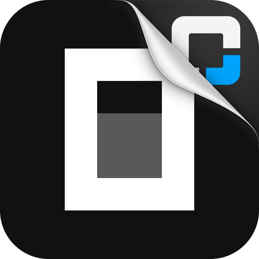

<p align="center">
  
</p>

<h1 align="center">OMC OpenCode Zen Free</h1>

<p align="center">
  <a href="https://github.com/WizisCool/oh-my-cpa">
    <picture>
      <source media="(prefers-color-scheme: dark)" srcset="https://raw.githubusercontent.com/WizisCool/oh-my-cpa/main/web/src/assets/brand/omc-wordmark-dark.svg">
      
    </picture>
  </a>
</p>

<p align="center">
  专为 Oh-My-CPA 适配，兼容
  <a href="https://github.com/router-for-me/CLIProxyAPI">CLIProxyAPI</a>
  的 OpenCode Zen 免费模型
</p>

<p align="center">
  <a href="https://github.com/omc-community/omc-opencode-zen-free/releases"></a>
  <a href="https://github.com/omc-community/omc-opencode-zen-free/actions/workflows/build.yml"></a>
  
  
</p>

<p align="center">
  <a href="README.md">English</a> · <a href="README.zh-CN.md">简体中文</a>
</p>

OMC OpenCode Zen Free 为 CLIProxyAPI 增加 `opencode-zen-free` provider。它使用 Zen
免费层唯一接受的公共凭证登录，发现 Zen 当前提供的免费模型，并以 OpenCode 自己的身份
发送每个请求；无需独立进程，也无需个人 Zen API Key。

本项目是 [Oh-My-CPA](https://github.com/WizisCool/oh-my-cpa) 生态的一部分：
Oh-My-CPA 是 CLIProxyAPI 的自托管控制面板与用量观测台。

## 一个公共身份，无需密钥

Zen 免费层不是付费套餐，也没有账号专属密钥。每个 OpenCode 安装都发送
`Bearer public`，而在个人 OpenCode 账号下创建的 Key 在这里不起作用。因此插件只注册
一个免密钥登录入口：没有密钥输入框，第一次轮询即完成流程。

插件保存的凭证就是这个公共身份本身。再次登录会替换同一个 auth 文件，而不是新增第二个
账号，因为不可能存在第二个账号。CPA 的 OAuth 面板要求插件流程返回一个 URL，因此登录
按钮指向本项目对免密钥身份说明；该页面无需任何操作，面板第一次轮询就会返回凭证。

个人 Zen Key 仍属于 CPA 内置的 OpenCode Zen provider（或 OpenCode 自己的 `opencode`
provider），那里可以配置多个 Key。本插件只负责共享的免费层。该共享额度按凭证整体计算：
`FreeUsageLimitError` 会在 **CPA v8.0.62+** 上冷却该凭证可达的全部免费模型；更旧的宿主只
冷却上报的模型。

## Zen 的要求，以及插件的做法

Zen 免费层只服务 OpenCode 自己的请求。插件逐项发送 OpenCode 2 发送的内容，顺序也
一致：

- OpenCode 的 `User-Agent`（`opencode/latest/<version>/cli`），形状来自 2.2.5；版本
  来自 OpenCode 自己的更新接口，而不是写死在发布里。
- 它的 `b3` 与 `traceparent` 追踪头：一个会话一条 trace，每个请求一个新 span。
- 它的 project id：`sha1("directory:" + 目录)`；当本机能读到该目录的仓库时，使用仓库
  的 remote。
- 它的 session id，同时写入 `x-opencode-session`、`x-opencode-session-id`、
  `x-session-affinity` 与 `x-session-id`，并符合 OpenCode 自己的 id 形状。
- 每个 OpenCode prompt 结尾的 `<env>` 块，其中写明 agent prompt 所述的工作目录（未
  写明时使用本机 home 目录）。固定的占位符会被拒绝，因此该块始终写真实路径。
- 当 agent 没有声明时，补上 OpenCode 的五个核心工具（`edit`、`glob`、`grep`、
  `read`、`shell`），并注明不可用。

Zen 已不再免费的模型会被回答为“未知模型”，并列出当前免费模型，而不是凭证失败，这样
CPA 可以把请求路由到别处。

## 功能

- 使用共享 `public` 凭证的免密钥登录。
- 从 Zen 的实时列表发现免费模型；该列表自带每个模型的上下文、模态、推理等级和请求
  协议。列表最多每分钟读取一次，并跨重启保存；models.dev 的 v2 catalog 和内置协议表
  只在旧版列表仅有 id 时兜底。Zen 标为 `-free`、但两个来源都尚未描述的新模型
  也会以 Chat Completions 提供。
- 输入输出均为 OpenAI Chat Completions，支持流式与非流式。Zen 总是流式返回；非流式
  客户端得到的是读完整条流后聚合的答案。
- 保留工具调用。Zen 的模型经常调用 OpenCode 自己的工具名；当 agent 只有一个工具仅
  大小写不同（`bash` → `Bash`），或仅大小写和 `_`/`-` 不同（`todowrite` →
  `todo_write`）时，调用会改写成 agent 的名字。agent 没有的工具按模型原名返回，与其
  他 provider 一致。
- 改写被拒绝的工具名。Zen 会对某些名字直接返回 429（含 `terminal` 的名字、
  `ReportFindings` 与 `ScheduleWakeup` 同时出现、DSH 的 `subagent_fork` 以及
  `read_image` 与 `working_directory` 同时出现、ZCode 的 workflow 组合、含 `run_code`
  的名字）。这些名字会以另一个名字发往 Zen，历史调用和 `tool_choice` 同样改写；调用
  返回时再还原成 agent 自己的名字。
- Zen 在 `[DONE]` 前关闭的流，如果已经输出内容且没有未完成的工具调用，会以普通停止
  结束，并在文本中说明被截断。
- 每凭证并发控制。
- 导入已有的 `"type": "opencode-zen-free"` auth 文件。
- 错误映射：共享额度用尽保持 429，身份被拒保持 403，不折叠成通用上游失败。限流同时
  说明还剩多久——上游给了 `Retry-After` 就用它，否则用免费额度 00:00 UTC 的重置时间，
  于是 CPA 会让模型休息，而不是对着已用尽的额度反复重试。

## 安装

把本仓库加为插件商店来源：

```yaml
plugins:
  enabled: true
  dir: /path/to/plugins
  store-sources:
    - https://raw.githubusercontent.com/omc-community/omc-plugins/main/official.json
  configs:
    omc-opencode-zen-free:
      enabled: true
```

然后在插件商店安装 `omc-opencode-zen-free`，在面板中打开它的登录卡片。商店与共享库
名称是 `omc-opencode-zen-free`；CPA 凭证 provider 标识是 `opencode-zen-free`。登录、
配置、模型和错误细节见 [docs/USAGE.md](docs/USAGE.md)。

推送 `v*` tag 时由 GitHub Actions 创建 release。

## 配置

| 字段 | 类型 | 默认值 | 取值 |
| --- | --- | --- | --- |
| `max_concurrency` | integer | `2` | 每凭证 1–100 个并发请求 |
| `opencode_version` | string | `2.2.5` | 无法读取 OpenCode 更新接口时客户端声称的版本 |
| `exclude_models` | array | `[]` | 本插件永不发布的模型 id |

Zen 免费层会拒绝旧版 OpenCode 发送的确切 `User-Agent`，因此 `opencode_version` 是下限：
插件最多每六小时询问一次 OpenCode 的更新接口，并使用它给出的更新版本。返回旧版本的
镜像不会被采纳。

当本凭证优先级最高、且没有其他 provider 提供某个模型时，`exclude_models` 很重要：
把 id 写在这里，CPA 从一开始就不会把该模型路由到免费层。

## 模型与路由

插件在启动时发现 Zen 当前的免费模型，之后最多每分钟刷新一次。请求的模型不在上次
列表中时，会再次询问列表，最多每分钟一次，因此 Zen 新免费的模型会立即被服务。上次
成功的列表会保存在 auth 目录旁，重启后即使无法访问 Zen 也能继续使用；内置 bootstrap
列表只用于首次运行且读取失败的情况。

- 模型 id 转小写用于 CPA 路由；Zen 自己的 key 原样发往上游。
- 已退役模型和 SystemOne 模型不发布。
- 只发布 Chat Completions 模型。Zen 通过 Responses 或 Anthropic Messages 提供的模型
  不发布：本 executor 只说 chat completions，发布一个无法服务的模型是更糟的答案。
- 列表读取失败时保留上次成功列表（重启后为已保存的列表）；完全没有列表时使用内置
  bootstrap 列表。
- 查找前会去掉 `vendor/model` 前缀。
- `deepseek-v4.1-flash-free` 以 258,624 token 的上下文下限发布：实时 catalog 写的是
  200,000，但上游一次 258,624 token 的用量被成功服务。报告超过厂商接受的值会把请求
  路由到注定失败的地方。

## 请求

请求发往 `https://opencode.ai/inference/openai/v1/chat/completions`，即 OpenCode 2
发送 chat 模型的地址。流式回复以裸 JSON payload 转发：SSE 帧和结尾的 `[DONE]` 由宿主
的 OpenAI handler 负责，因此每个 payload 只会到达客户端一次。

Zen 的模型会收到 agent 的工具、五个核心占位工具和 OpenCode 的环境块。工具调用会等到
参数完整后一次性发送，并还原成 agent 自己的名字。没有名字的调用会被丢弃，回复文本会
说明；如果整轮所有调用都被丢弃，则以普通答案结束。

## 开发

插件实现位于 [`go/`](go/)。模块下载完成后，测试无需网络：

```sh
cd go
go mod download
GOPROXY=off GOSUMDB=off go test ./...
GOPROXY=off GOSUMDB=off go vet ./...
```

为当前机器构建原生库：

```sh
cd go
CGO_ENABLED=1 go build -buildmode=c-shared -o ../build/omc-opencode-zen-free.so .
```

macOS 使用 `.dylib`，Windows 使用 `.dll`。`build/` 已被 git 忽略。

推送 tag 时，release workflow 构建以下产物：

```text
omc-opencode-zen-free_<version>_linux_amd64.zip
omc-opencode-zen-free_<version>_linux_arm64.zip
omc-opencode-zen-free_<version>_darwin_amd64.zip
omc-opencode-zen-free_<version>_darwin_arm64.zip
omc-opencode-zen-free_<version>_windows_amd64.zip
omc-opencode-zen-free_<version>_windows_arm64.zip
checksums.txt
omc-opencode-zen-free.omc.json
```

每个压缩包根目录包含正确命名的 `omc-opencode-zen-free.so`、`.dylib` 或 `.dll`。
`checksums.txt` 覆盖所有压缩包，插件商店下载后会校验。`omc-opencode-zen-free.omc.json`
是 [docs/USAGE.md](docs/USAGE.md) 所述的可选描述声明；插件发布与内嵌的是同一份字节。

提交规范、测试要求和生态开发标准见 [CONTRIBUTING.md](CONTRIBUTING.md)。

## 项目结构

```text
assets/logo.png          插件贴纸：在商店中的门面
assets/zen.png           OpenCode Zen 标识，用于登录卡片
go/                      Go/cgo 插件实现与测试
go/assets/               内嵌图片与 omc.json 声明
docs/USAGE.md            运维安装与使用指南
```

Go 实现是独立代码。协议来源，包括登录身份、请求头和工具规则，记录在
[NOTICE.md](NOTICE.md)。

## 许可证

[MIT](LICENSE)
